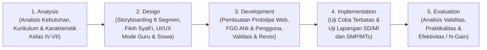

# Sinopsis Awal Penelitian R&D & Laporan Simulasi Kritik FGD
**Produk:** Media Pembelajaran Digital *Adab Wudhu Multi-Sensory* (Mazhab Syafi'i)  
**Peneliti:** Farihan Muhammad Putra — Magister Pendidikan Agama Islam (MPAI), Pascasarjana Universitas Islam Riau (UIR)

> [!NOTE]
> **Klarifikasi Istilah Metodologi:** Istilah yang dimaksud oleh dosen prodi dalam penelitian R&D umumnya adalah **FGD (*Focus Group Discussion*)** — yaitu forum diskusi terarah yang melibatkan para pakar (ahli materi, ahli media, praktisi/guru) dan perwakilan pengguna untuk menguji, mengkritisi, dan menyempurnakan draf awal produk sebelum masuk tahap validasi formal dan uji lapangan.

---

# BAGIAN I: SINOPSIS AWAL PENELITIAN R&D (UNTUK PENGAJUAN KE PRODI)

## 1. Usulan Judul Penelitian
**Opsi Utama (Direkomendasikan):**
> **Pengembangan Media Pembelajaran Interaktif *Adab Wudhu Multi-Sensory* Berbasis Web Menurut Mazhab Syafi'i untuk Meningkatkan Pemahaman dan Kualitas Praktik Wudhu Peserta Didik Fase B–D (Kelas IV–VII)**

**Alternatif Lebih Ringkas:**
> **Pengembangan Media Pembelajaran *Multi-Sensory Digital* Berbasis Web pada Materi Tata Cara dan Adab Wudhu Mazhab Syafi'i bagi Peserta Didik Tingkat SD/MI dan SMP/MTs**

---

## 2. Latar Belakang & Rasionalisasi: Mengapa Penelitian Ini Harus Berbentuk R&D?

Penelitian ini dirancang menggunakan pendekatan ***Research and Development* (R&D)** — bukan sekadar penelitian deskriptif atau eksperimen biasa — atas empat alasan ilmiah dan empiris berikut:

1. **Kesenjangan Empiris di Lapangan (*Need Analysis*):**
   Pembelajaran fikih wudhu pada peserta didik kelas IV–VII (usia transisi *mumayyiz* menuju *baligh*) selama ini masih didominasi metode ceramah, gambar statis di buku cetak, atau video pasif satu arah. Akibatnya, banyak peserta didik yang:
   - Melakukan wudhu secara tergesa-gesa (kurang *thuma'ninah*) dan boros air (*israf*).
   - Keliru memahami batas wajib anggota wudhu menurut Mazhab Syafi'i (misalnya batas wajah, siku, sebagian kepala, dan mata kaki).
   - Belum memahami praktik fikih kontekstual seperti **wudhu menggunakan gayung/bak air** (kaidah air *musta'mal* dan 2 Qullah) serta **ketentuan khusus siswi berhijab**.
2. **Belum Tersedianya Produk Solutif yang Terintegrasi (*Product Gap*):**
   Media digital wudhu yang beredar saat ini umumnya hanya berupa video pasif (tidak menstimulasi kinestetik/interaktivitas), tidak membedakan kedalaman materi antara jenjang SD/MI (kelas IV–VI) dan SMP/MTs (kelas VII), serta tidak memiliki mekanisme evaluasi pemahaman yang terkontrol. Oleh karena itu, peneliti **harus merancang, mengembangkan, dan memvalidasi produk baru** secara sistematis.
3. **Menjawab Tuntutan Pedagogik *Multi-Sensory* (VAK):**
   Materi wudhu bersifat psikomotorik sekaligus afektif (adab). Penelitian R&D memungkinkan peneliti mengintegrasikan modalitas **Visual** (21 animasi peragaan Putra & Putri + *Zoom* Batas Wajib), **Auditori** (narator audio + musik latar Islami *auto-ducking*), dan **Kinestetik** (eksplorasi titik batas wajib berurutan + tempo *thuma'ninah* 3× hitungan) ke dalam satu prototipe teruji.
4. **Menghasilkan Luaran Terukur (Valid, Praktis, dan Efektif):**
   Dengan metode R&D, penelitian ini tidak hanya menguji apakah media tersebut berpengaruh, tetapi juga membuktikan kelayakan produk dari aspek **validitas** (ahli materi fikih, ahli media/TI, ahli bahasa), **praktikalitas** (kemudahan penggunaan oleh guru melalui *Mode Guru* dan siswa melalui *Mode Siswa*), serta **efektivitas** (peningkatan skor pemahaman melalui data *Cek Pemahaman* terintegrasi).

---

## 3. Rumusan Masalah Penelitian
1. Bagaimana prosedur pengembangan media pembelajaran interaktif *Adab Wudhu Multi-Sensory* berbasis web menurut Mazhab Syafi'i untuk peserta didik kelas IV–VII?
2. Bagaimana tingkat **validitas** media pembelajaran *Adab Wudhu Multi-Sensory* berdasarkan penilaian ahli materi fikih, ahli media pembelajaran, dan ahli bahasa?
3. Bagaimana tingkat **praktikalitas** media pembelajaran *Adab Wudhu Multi-Sensory* berdasarkan respon guru PAI dan peserta didik tingkat SD/MI (kelas IV–VI) serta SMP/MTs (kelas VII)?
4. Bagaimana tingkat **efektivitas** media pembelajaran *Adab Wudhu Multi-Sensory* dalam meningkatkan pemahaman tata cara dan adab berwudhu peserta didik?

---

## 4. Model Pengembangan & Tahapan R&D (Model ADDIE)

Penelitian ini menggunakan model pengembangan **ADDIE** (*Analysis, Design, Development, Implementation, Evaluation*) yang dipadukan dengan tahapan **FGD (*Focus Group Discussion*)**:

---

## 5. Spesifikasi Produk yang Dikembangkan
- **Platform:** Aplikasi Web Responsif (1 Tautan Utama & QR Code, tanpa instalasi, lintas HP/Laptop/Proyektor).
- **Arsitektur Dual-Mode:**
  - **Mode Guru (Berpassword):** Khusus presentasi & pengajaran di kelas (tanpa tab kuis/indikator siswa, bebas navigasi).
  - **Mode Siswa (Kelas IV–VII):** Terdiferensiasi otomatis antara materi **SD/MI** (ringkas & ramah anak) dan **SMP/MTs** (mendalam, berbasis kitab *Fath al-Qarib* & *Ihya' 'Ulum al-Din*), dilengkapi *100% Mastery Gate* (tidak dapat keluar sebelum menuntaskan materi) serta penguncian identitas sejak halaman awal.
- **Konten Inti:** 8 Segmen × 21 Sub-gerakan Animasi Putra & Putri (Berhijab), Tab *Wudhu Gayung* (Kaidah 2 Qullah), Zona Kinestetik (2 Tantangan Interaktif), 10 Soal *Cek Pemahaman* terdiferensiasi, dan integrasi rekap otomatis ke **Google Sheets** (terpisah 2 tab: `Rekap SD / MI` dan `Rekap SMP / MTs`).

---

## 6. Rancangan Teknik Analisis Data
- **Uji Validitas (Ahli Materi, Media, Bahasa):** Skala Likert 1–5 dianalisis dengan persentase kelayakan / indeks *Aiken's V*.
- **Uji Praktikalitas (Guru & Siswa):** Angket respon pengguna (kemudahan, kemenarikan, keterbacaan, kemanfaatan).
- **Uji Efektivitas:** Desain *One-Group Pretest-Posttest* atau *Quasi-Experiment (Control vs Experimental)* menggunakan skor **Cek Pemahaman** (dan rubrik observasi praktik wudhu) dianalisis dengan **N-Gain Score** dan uji beda (*Paired Sample t-Test* / *Wilcoxon*).

---

# BAGIAN II: SIMULASI KRITIK PANEL FGD (*FOCUS GROUP DISCUSSION*)

Berikut adalah hasil bedah kritis terhadap produk website **[Adab Wudhu Multi-Sensory](https://farihanputra57-a11y.github.io/Media-Adab-Wudhu/)** dari **3 sudut pandang panel FGD** agar Anda sudah siap menjawab kritik dosen maupun memperbaiki celah produk sebelum uji lapangan.

---

## A. Perspektif 1: Ahli Media Pembelajaran & UI/UX Digital

> [!WARNING]
> **Temuan Kritis Ahli Media (Harus Diperhatikan Sebelum Validasi):**

1. **Potensi Kendala *Pretest–Posttest* & Duplikasi Data di Google Sheets:**
   - **Kritik:** Saat ini di tab Cek Pemahaman hanya ada 1 kali pengiriman tanpa penanda apakah itu **Pretest** (sebelum memakai media) atau **Posttest** (sesudah memakai media). Jika siswa mengerjakan ulang dari awal untuk Posttest, baris datanya di Google Sheets tidak otomatis tertandai "Pretest" atau "Posttest" sehingga peneliti harus memilah manual berdasarkan jam pengiriman.
   - **Saran Perbaikan:** Tambahkan opsi/label sesi (*Pretest* / *Posttest* / *Latihan*) atau kolom penanda di Google Sheets jika penelitian Anda menggunakan desain *Pretest–Posttest*.
2. **Kebergantungan Koneksi Internet untuk Audio MP3 & Font:**
   - **Kritik:** File audio narasi (`narasi_lengkap.mp3` ±4,8 MB dan `narasi_putri.mp3` ±3,4 MB) diunduh dari GitHub Pages. Di sekolah dengan sinyal seluler lemah saat 30 siswa membuka bersamaan, audio MP3 bisa mengalami *buffering* beberapa detik sebelum berbunyi (meski sudah ada *fallback* suara browser).
   - **Saran Perbaikan:** Kompresi *bitrate* MP3 (misalnya ke 64 kbps mono — ukuran turun 60% tanpa mengurangi kejernihan suara manusia) atau tambahkan indikator loading kecil saat MP3 sedang dimuat.
3. **Ketiadaan Tombol Kontrol Volume / *Mute* BGM untuk Siswa Sensitif Suara:**
   - **Kritik:** Musik latar (*backsound*) sengaja dibuat selalu menyala tanpa tombol bisu (*mute*). Secara prinsip desain inklusif (UDL — *Universal Design for Learning*) dan kelas dengan 30 HP menyala serentak tanpa *headset*, 30 perangkat yang memutar BGM bersamaan akan menciptakan **kebisingan kelas (*audio clash*)**!
   - **Saran Perbaikan:** Sangat disarankan menyediakan tombol kecil **🔊/🔇 BGM** di pojok atas (default tetap menyala, tetapi siswa/guru bisa mengecilkan atau mematikan BGM saat dipakai massal di kelas tanpa *earphone*).
4. **Aksesibilitas Layar HP Kecil pada Tampilan *Side-by-Side* Putra & Putri:**
   - **Kritik:** Di layar HP berukuran kecil (lebar 360px), dua panggung animasi Putra & Putri berdampingan atau bertumpuk membuat siswa harus banyak menggulir (*scroll*) ke bawah untuk membaca teks penjelasan dan tombol *Next*.
   - **Saran Perbaikan:** Sediakan tombol filter ringkas di atas panggung animasi (**Putra & Putri | Khusus Putra | Khusus Putri**) khusus untuk mode layar HP agar fokus visual anak kelas IV SD tidak terpecah.

---

## B. Perspektif 2: Ahli Materi Fikih PAI & Pedagogik

> [!IMPORTANT]
> **Temuan Kritis Ahli Materi & Pedagogik:**

1. **Belum Adanya Indikator Rinci "Hal-Hal yang Membatalkan Wudhu" (*Nawaqidh al-Wudhu*) & Syarat Sah Wudhu Secara Eksplisit:**
   - **Kritik:** Meskipun fokus tesis Anda adalah **Tata Cara & Adab Wudhu**, penguji ahli materi fikih Mazhab Syafi'i sering menanyakan: *"Di mana penjelasan singkat syarat sah wudhu (seperti air suci menyucikan dan tidak adanya penghalang air seperti cat/kuteks) serta pembatal wudhu?"* Sebagian sudah terselip di catatan putri/segmen, tetapi belum disajikan dalam 1 kartu ringkasan khusus.
   - **Saran Perbaikan:** Tambahkan 1 kotak/modal ringkas **"Syarat Sah & Pembatal Wudhu (Mazhab Syafi'i)"** di Beranda atau akhir Segmen 8.
2. **Keamanan & Ketepatan Redaksi Soal Cek Pemahaman (Validitas Isi / *Content Validity*):**
   - **Kritik:** 10 soal Cek Pemahaman saat ini baru berupa pilihan ganda kognitif (*C1–C4*). Padahal judul/tujuan penelitian Anda menyasar **Adab dan Praktik Wudhu** (ranah afektif & psikomotorik).
   - **Saran Perbaikan:** Dalam proposal R&D, tegaskan bahwa **Cek Pemahaman 10 soal di dalam web** mengukur ranah **kognitif (pemahaman tata cara & adab)**, sementara ranah **psikomotorik (praktik wudhu nyata)** diukur menggunakan **Lembar Observasi Praktik Wudhu** secara langsung di tempat wudhu sekolah! Ini akan membuat metodologi Anda sangat kokoh di hadapan penguji.
3. **Ketiadaan Teks Doa dengan Harakat Lengkap + Audio Bacaan Doa Khusus (Niat & Doa Setelah Wudhu):**
   - **Kritik:** Siswa kelas IV SD banyak yang masih terbata-bata membaca teks Arab niat wudhu dan doa setelah wudhu. Perlu dipastikan pelafalan *makharijul huruf* pada audio niat dan doa setelah wudhu benar-benar fasih (sesuai kaidah tajwid) karena anak SD meniru langsung apa yang didengar.
   - **Saran Perbaikan:** Pastikan saat validasi ahli materi, audio bacaan Arab (*Basmalah*, niat, dan doa setelah wudhu) diperdengarkan langsung kepada dosen ahli fikih/Al-Qur'an Hadis untuk disetujui kefasihannya.
4. **Kesesuaian Rentang Kelas IV–VII dengan Pembagian SD/MI vs SMP/MTs:**
   - **Kritik:** Validasi saat ini membatasi input **Kelas 4–7**, namun sistem belum mencegah siswa **Kelas 4** memilih kartu **SMP/MTs**, atau siswa **Kelas 7** salah klik kartu **SD/MI**.
   - **Saran Perbaikan:** Tambahkan validasi sinkronisasi otomatis di halaman awal: **Kelas 4, 5, 6 → wajib SD/MI**, dan **Kelas 7 → wajib SMP/MTs** (atau otomatis terpilih jenjangnya begitu siswa mengetik angka kelas!).

---

## C. Perspektif 3: Pengguna (Guru PAI & Siswa Kelas IV–VII)

> [!TIP]
> **Temuan Kritis Pengguna Lapangan (Guru & Siswa):**

1. **Ketidaknyamanan Penguncian 100% Jika HP Siswa Tidak Sengaja Ter-refresh atau Baterai Habis:**
   - **Kritik (Dari Sisi Siswa):** Karena progres pembelajaran sengaja direset ke `0%` setiap kali halaman di-*refresh*, jika seorang siswa sudah menyelesaikan 7 dari 8 segmen lalu HP-nya tidak sengaja tersentuh tombol *refresh* atau sinyal putus, ia harus mengulang dari `0%` lagi untuk bisa keluar. Ini berisiko membuat siswa kelas IV–V SD frustrasi.
   - **Saran Perbaikan:** Pertimbangkan menyimpan progres sementara di `sessionStorage` selama sesi siswa masih aktif (sehingga *refresh* tidak menghilangkan progres), dan baru direset ke `0%` **setelah siswa selesai 100% dan keluar otomatis** ke Halaman Awal.
2. **Durasi Latihan Kinestetik 3× Hitungan (6,5 Detik per Hitungan):**
   - **Kritik (Dari Sisi Siswa Kelas IV SD):** Waktu 6,5 detik per hitungan sangat baik untuk melatih *thuma'ninah*, namun bagi anak kelas IV SD, jeda 6,5 detik tanpa suara hitungan/detik ("Satu... pelan-pelan... Dua...") bisa terasa seperti aplikasi macet.
   - **Saran Perbaikan:** Tambahkan *progress bar* / lingkaran hitung mundur halus di dalam lingkaran tempo agar anak melihat visual waktu berjalan dengan tenang.
3. **Kemudahan Guru Mengakses Rekap Nilai Tanpa Harus Buka Google Drive Manual:**
   - **Kritik (Dari Sisi Guru):** Di dalam **Mode Guru**, guru sudah sangat nyaman mengajar tanpa terganggu menu kuis siswa. Namun, jika guru ingin langsung melihat hasil **Google Sheets** setelah kelas selesai, guru harus membuka tab baru secara manual.
   - **Saran Perbaikan:** Di panel **Identitas Pengajar (Mode Guru)** pada Beranda, bisa ditambahkan 1 tombol kecil **"📊 Buka Rekap Google Sheets"** yang langsung membuka tautan spreadsheet guru di tab baru.
4. **Petunjuk Penggunaan Singkat (*User Guide*) untuk Siswa Baru:**
   - **Kritik (Dari Sisi Guru & Siswa):** Belum ada tombol **"❓ Panduan Pakai"** (3 langkah singkat: *1. Pelajari 8 Segmen → 2. Selesaikan 4 Area Kinestetik → 3. Kerjakan 10 Soal Cek Pemahaman hingga 100%*). Padahal dalam angket validasi ahli media R&D, **keberadaan petunjuk penggunaan** hampir selalu menjadi salah satu butir penilaian wajib!

---

## Ringkasan Prioritas Revisi Pasca-FGD (Jika Ingin Segera Diterapkan)

| Prioritas | Masukan FGD | Dampak pada Penilaian R&D |
| :---: | :--- | :--- |
| **Tinggi** | Tambahkan tombol **❓ Panduan Penggunaan** (3 langkah alur belajar) | Menjawab butir wajib instrumen Validasi Ahli Media |
| **Tinggi** | Sinkronisasi otomatis **Kelas 4–6 → SD/MI** & **Kelas 7 → SMP/MTs** | Mencegah salah pilih jenjang oleh siswa saat uji lapangan |
| **Tinggi** | Tambahkan tombol **🔊/🔇 BGM** agar tidak bentrok suara saat 30 HP dipakai serentak di kelas | Meningkatkan skor Praktikalitas di ruang kelas nyata |
| **Sedang** | Tambahkan tombol **"📊 Buka Rekap Google Sheets"** khusus di Beranda Mode Guru | Memudahkan guru mengecek hasil siswa pasca-mengajar |
| **Sedang** | Simpan progres di `sessionStorage` selama sesi aktif agar tidak hilang jika *refresh* tak sengaja | Mencegah frustrasi siswa kelas IV–V saat uji lapangan |

---

## D. Evaluasi & Tindak Lanjut FGD Tahap 2 (Putaran Kedua Pasca-Revisi)

Seluruh **9 temuan penyempurnaan FGD Tahap 2** dari perspektif **Ahli Media**, **Ahli Materi Fikih (Mazhab Syafi'i)**, dan **Praktisi Guru PAI** telah diimplementasikan dan diverifikasi langsung pada web produksi (`f74e08e`, `d0642e1`, `19b4976`):

| No | Perspektif FGD | Temuan & Masukan Tahap 2 | Tindak Lanjut pada Web (Status: ✅ Selesai) |
| :-: | :--- | :--- | :--- |
| 1 | **Ahli Media** | Penyeragaman animasi anatomi berurutan `1 → 2 → 3` pada seluruh 6 langkah **Wudhu Gayung** | Seluruh **Langkah 1–6 Wudhu Gayung** kini dilengkapi model anatomi 5 jari/wajah/lengan/kepala/kaki bergradasi, lencana nomor **`1 → 2 → 3`**, dan jalur alur bergerak (`.anim-trail`). |
| 2 | **Ahli Media** | Penghilangan *scrollbar* horizontal kasar pada *header* & *stepper* serta perampingan *sticky header* di HP | Navigasi utama dan *stepper* dirapikan (`scrollbar-width: none`, *padding* adaptif) sehingga seluruh tombol menu termasuk **`🚪 Keluar`** tampil utuh dalam 1 baris tanpa terpotong. |
| 3 | **Ahli Media** | Perapian teks pada kartu kanan **Segmen 8B (`Doa Setelah Wudhu`)** | Ukuran kotak dan tipografi disesuaikan (`width="304"`) sehingga teks Arab serta petunjuk doa tidak menyentuh garis tepi bingkai. |
| 4 | **Ahli Fikih** | Visualisasi alur *Anti-Musta'mal* & *Anti-Cipratan* pada **Wudhu Gayung** (bak `< 2 Qullah`) | Ditampilkan alur tegas **`① Ciduk Gayung → ② Angkat Keluar → ③ Tuang & Basuh di Luar Bibir Bak`** agar tetesan air basuhan tidak memercik kembali ke dalam bak. |
| 5 | **Ahli Fikih** | Pembedaan tegas **Rukun Kepala** vs **Sunnah Meratakan & Telinga** di **Zona Kinestetik** | Ditambahkan dua lencana fikih di atas diagram kepala: **`RUKUN: Sebagian Kepala (①)`** dan **`SUNNAH: Ratakan (②–③) & Telinga`**, selaras 100% dengan arah sapuan `1 → 2 → 3`. |
| 6 | **Ahli Fikih** | Visualisasi urutan **Adab Berdoa** pada **Segmen 8 (`Doa Setelah Wudhu`)** | Ditampilkan jalur urutan **`① Menghadap Kiblat → ② Angkat Tangan → ③ Berdoa Khusyuk`** beserta lafal syahadat pembuka doa. |
| 7 | **Guru PAI** | Pilihan *default* sesi di Halaman Awal diarahkan ke **`📝 Pretest (Tes Awal)`** | Kolom **`3. Pilih Sesi`** di Halaman Awal kini otomatis memilih **`Pretest (Tes Awal)`** saat pertama kali dibuka agar siswa tidak melewati tes awal. |
| 8 | **Guru PAI** | Penyesuaian catatan kaki dinamis saat memilih **`👨‍🏫 Mode Guru (Mengajar)`** | Saat tab **Mode Guru** dipilih, catatan bawah kartu otomatis berubah menjelaskan fitur proyektor, rekapan Google Sheets, dan Rubrik Observasi Praktik (tanpa kuis siswa). |
| 9 | **Guru PAI** | Umpan balik suara singkat otomatis saat siswa menemukan titik **`1✓ → 2✓ → 3✓`** di **Zona Kinestetik** | Ditambahkan fungsi `speakKinestheticPoint()` (*Web Speech* Bahasa Indonesia) yang membacakan nama batas wajib secara otomatis setiap kali titik ditemukan. |

---

## E. Evaluasi & Tindak Lanjut FGD Tahap 3 (Putaran Ketiga / Finalisasi Uji Lapangan)

Seluruh **8 poin kritik dan penyempurnaan FGD Tahap 3** dari perspektif **Ahli Media**, **Ahli Materi Fikih (Mazhab Syafi'i)**, dan **Praktisi Guru PAI** telah diimplementasikan secara menyeluruh pada web produksi:

| No | Perspektif FGD | Temuan & Kritik Tahap 3 | Tindak Lanjut pada Web (Status: ✅ Selesai) |
| :-: | :--- | :--- | :--- |
| 1 | **Ahli Media** | Baris identitas siswa terkunci (*Jenjang, Nama Lengkap, Asal Sekolah, Kelas*) pada halaman Kuis melebar melewati batas kanan layar HP (`375×812`) | Lebar kaku `.student-field-class { width: 165px }` dihapus dan diubah ke `width: 100%; min-width: 0` sehingga pada layar ponsel sempit (`375px`) otomatis menyusun rapi tanpa ada teks kelas yang terpotong. |
| 2 | **Ahli Media** | Keterbatasan *dropdown* filter `B2` (`Kelas`) & `D2` (`Filter Sesi`) saat Google Sheets dikunci ke mode **`Pelihat (Viewer)`** | Ditambahkan fitur **`📊 Filter Rekap & Analisis N-Gain (Live di Web)`** pada Beranda **Mode Guru** yang mengambil data langsung dari Google Sheets dan memungkinkan guru memfilter **Sekolah (8 sekolah)**, **Kelas (`4A–7D`)**, serta **Sesi (`Pretest`/`Posttest`/`Latihan`)** langsung di dalam aplikasi web tanpa perlu mengubah sel di Google Sheets. |
| 3 | **Ahli Media** | Tata letak cetak (`@media print`) masih menyertakan *topbar* dan elemen navigasi saat mencetak Rubrik atau Rekap | Ditambahkan aturan `@media print` di `css/styles.css` yang otomatis menyembunyikan *topbar*, tombol aksi, dan latar modal sehingga hasil cetak/PDF Rubrik Observasi maupun Tabel Rekap Nilai tampil bersih siap dilampirkan pada tesis. |
| 4 | **Ahli Fikih** | Pemisahan tegas antara **Basmalah & Doa Sunnah Awal Wudhu** (Segmen 1) dengan **Niat Fardu Wudhu** (Segmen 3) | Pada **Segmen 1**, kartu doa kini khusus menampilkan *Basmalah & Doa Sunnah Awal Wudhu* (*"Bismillahirrahmanirrahim, Alhamdulillahilladzi ja'alal ma'a thahuran"*) saat membasuh telapak tangan; sedangkan pada **Segmen 3 (Membasuh Wajah)** ditampilkan kartu khusus **Lafal Niat Fardu Wudhu** (*"Nawaitul wudhu'a..."*) yang wajib dihadirkan di hati berbarengan dengan basuhan pertama wajah (*muqaranah bil fi'li*). |
| 5 | **Ahli Fikih** | Penegasan mengambil **air baru (*ma'un jadid*)** saat mengusap kedua telinga pada **Segmen 5C** | Pada **Segmen 5 & Gerakan 5C**, ditegaskan bahwa telinga adalah sunnah tersendiri (bukan bagian dari wajah maupun kepala) sehingga dianjurkan mengambil air baru (*ma'un jadid*) untuk mengusap bagian dalam dan belakang daun telinga. |
| 6 | **Ahli Fikih** | Penegasan perbedaan hukum **Tertib (Rukun Wajib)** vs **Muwalat & Tayammun (Sunnah Mu'akkadah)** pada **Segmen 7** | Pada **Segmen 7 (`Tertib & Tenang`)** baik jenjang SD/MI maupun SMP/MTs, ditambahkan penjelasan komparatif antara **Tertib** (*Rukun wajib ke-6*) dengan **Muwalat** (*berkesinambungan sebelum anggota sebelumnya kering — sunnah bagi orang sehat, wajib bagi daimul hadats*) dan **Tayammun** (*mendahulukan anggota kanan — sunnah mu'akkadah*). |
| 7 | **Guru PAI** | Siswa SD bingung mengapa tombol **`📤 Kirim & Kunci Hasil`** belum muncul jika ada 1 soal yang terlewat di tengah | Ditambahkan *sticky banner* **`📝 Progres Jawaban: X / 10 Soal`** di bagian atas kuis serta kartu peringatan **`#quiz-missing-alert-card`** di bagian bawah yang menyebutkan secara spesifik nomor soal yang belum dijawab (misal: *"Soal Nomor 4, 7"*). |
| 8 | **Guru PAI** | Kebutuhan perhitungan otomatis efektivitas **Pretest vs Posttest (*N-Gain*)** untuk analisis R&D Tesis | Di dalam modal **`📊 Filter Rekap & Analisis N-Gain (Live di Web)`** pada Mode Guru, sistem kini otomatis menghitung **Rata-Rata Pretest**, **Rata-Rata Posttest**, selisih kenaikan (**Δ %**), dan skor **N-Gain Hake ($g$)** beserta kategorinya (*Tinggi / Sedang / Rendah*) per sekolah dan per kelas. |
